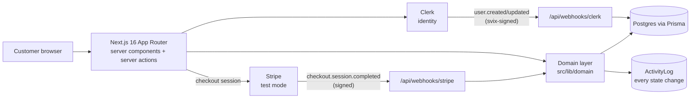
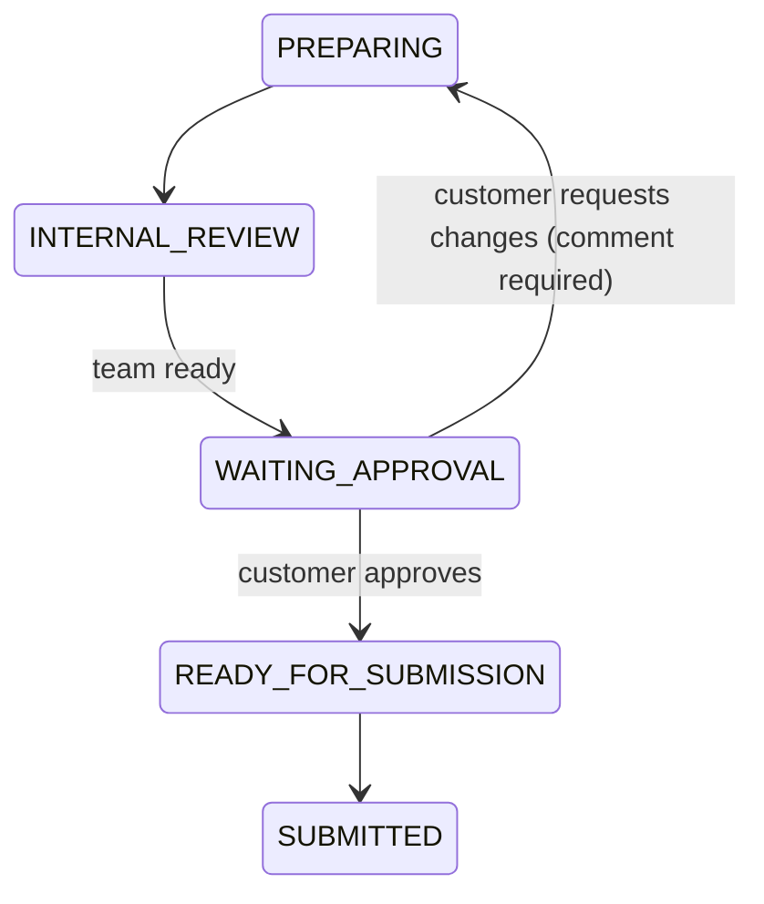

# Operon

**A managed job-application service: the customer owns the career decisions, and Operon's team runs the execution.** Customers subscribe, a team prepares tailored applications, and, depending on the customer's chosen mode, each application waits for the customer's approval before it is submitted.

> [!NOTE]
> **Status: Phase 1 prototype. Not launched, no customers.** This repository is the working foundation: domain model, authentication, self-serve subscription checkout in **Stripe test mode**, and the customer approval dashboard. The product and operations design documents it references (`operon-docs/…`) are not included in this repository.

---

## The problem

Senior job searches are a second job: finding roles, tailoring a résumé per archetype, writing cover letters, submitting, and tracking dozens of threads. Fully automated "apply bots" take control away from the candidate; doing it all yourself takes hours every week.

Operon's bet is a middle path: **people do the work, and the candidate keeps a veto.** That makes the system's hard problems about trust and accountability:

- Who did what to my application, and when?
- Can anything be submitted without my approval?
- If I'm charged, will I definitely get an account, and only once?

## What is implemented

| Area | Implemented | Where |
|---|---|---|
| Domain model | 20 models and 18 enums mirroring the documented customer, application, document, task and interview lifecycles | [`prisma/schema.prisma`](prisma/schema.prisma) |
| Auth | Clerk sign-in/up. Local `User` synced by a verified Clerk webhook, with a lazy-create fallback so a delayed webhook never locks anyone out | `src/lib/auth.ts`, `src/app/api/webhooks/clerk` |
| Subscription checkout | Stripe Checkout (test mode), one self-serve tier. Other tiers shown as "Contact us" until priced | `src/app/api/checkout`, `src/lib/stripe.ts` |
| Signup on payment | Verified Stripe webhook → customer created **exactly once** per event, in one transaction with the event marker | `src/app/api/webhooks/stripe`, `src/lib/domain/stripe-events.ts` |
| Capacity kill switch | `signups_paused` platform setting routes new buyers to a waitlist page, because a service business can't scale like software | `src/lib/domain/customer.ts` |
| Customer dashboard | Applications by status, documents and recent activity. Approve or request changes on applications awaiting approval | `src/app/(customer)/dashboard` |
| Ownership enforcement | Every query is scoped to the session's customer, and actions verify ownership before acting | `src/lib/domain/customer-queries.ts` |
| Approval engine | Legal only from `WAITING_APPROVAL / PENDING`. Compare-and-set update, so double clicks and stale tabs can't double-transition. Every change goes to `ActivityLog` | `src/lib/domain/application.ts` |

**Not built yet:** the internal team workspace (associates and managers), job sourcing, document generation, submission tracking, notifications, and Mode B auto-submit execution. The schema models them; no code drives them.

## Architecture



All state changes go through `src/lib/domain`. Routes and server actions never write lifecycle fields directly.

### Application approval (Mode A)



Only the two customer transitions are implemented in code today. The others are modelled states for the team workflow.

## Key decisions

| Decision | Why | Record |
|---|---|---|
| Ship self-serve checkout before the sales-assisted funnel, but still log every documented funnel state | Faster to first revenue without corrupting the lifecycle data analytics will rely on later | [ADR-0001](docs/adr/0001-collapsed-self-serve-funnel.md) |
| Exactly-once Stripe webhook processing via a marker row in the same transaction | Stripe delivers at least once, and a customer must never get two accounts or half an account | [ADR-0002](docs/adr/0002-exactly-once-stripe-webhooks.md) |
| Approval as compare-and-set on `(status, approvalStatus)` | Two tabs, a double click, or a page left open overnight must not act on a stale state | [`application.ts`](src/lib/domain/application.ts) |
| Lazy user creation alongside the Clerk webhook | Local development has no public webhook URL, and production must survive webhook delays | [`auth.ts`](src/lib/auth.ts) |
| Only Tier 1 sold self-serve | Tiers 2–4 are unpriced. Showing a price that doesn't exist is worse than "Contact us" | [`stripe.ts`](src/lib/stripe.ts) |

## Local setup

Requires Node 24+, a Postgres database, and free Clerk and Stripe (test mode) accounts.

```bash
npm ci                      # also runs `prisma generate`
cp .env.example .env        # fill in test-mode keys
npm run db:migrate          # applies prisma/migrations
npm run dev                 # http://localhost:3000
```

For Stripe webhooks locally: `stripe listen --forward-to localhost:3000/api/webhooks/stripe` and put the printed `whsec_…` in `.env`.

Demo data without paying: sign up, visit `/welcome` once, then `node scripts/seed-demo-customer.mjs you@example.com`. All seeded companies and outcomes are fictional.

## Testing

```bash
npm test          # 13 unit tests
npm run typecheck
npm run lint
```

What's covered: the approval rules, approve and request-changes (including refusal from every non-waiting state, double clicks, and comment validation), the collapsed-funnel signup (order of logged transitions, idempotent replay), and exactly-once Stripe event processing (duplicate redelivery, rollback when applying fails).

> [!IMPORTANT]
> These are **unit tests against an in-memory fake of the Prisma calls**, not integration tests against Postgres. They verify domain logic. They do not verify SQL, constraints or Prisma behaviour. Integration tests on a disposable Postgres are the next testing step. `next build` is not run in CI because it needs Clerk keys at build time.

## Security notes

- Webhooks: Stripe signatures via `stripe.webhooks.constructEvent`, Clerk signatures via svix. Unverified requests get 400.
- Authorization: customers can act only on applications they own (`getOwnedApplicationOrThrow`).
- Secrets live only in `.env` (git-ignored, never committed; history checked). CI scans with gitleaks.
- Payments: Stripe-hosted Checkout, so no card data touches this app.
- Dependencies: `npm audit --omit=dev` (October 2026) reports one remaining high-severity advisory chain, `deepmerge-ts` < 8 via `@prisma/config` → `prisma`. It is reached only through the Prisma CLI, an optional peer of `@prisma/client`, not the request path. The fix requires Prisma 7, a major upgrade that is deliberately deferred.

## Roadmap (next three)

1. Integration tests on a disposable Postgres (constraints, the Stripe marker under concurrency).
2. Handle `customer.subscription.updated/deleted` so `subscriptionStatus` mirrors Stripe.
3. Team workspace: associate queue and manager review, which feeds `WAITING_APPROVAL`.

---

Built by [Karthik Bhumireddy](https://github.com/karthikbhumireddy), product owner and builder, with Claude Code as an AI pair programmer.
